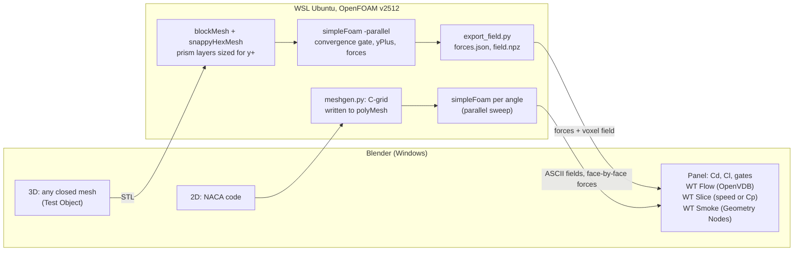

# Wind Tunnel for Blender (OpenFOAM in WSL)

[](https://github.com/azzbilal/blender-openfoam-wind-tunnel/actions/workflows/tests.yml)


A Blender add-on that puts any closed mesh, or a NACA 4-digit airfoil, into a virtual wind tunnel: it
writes an OpenFOAM case, solves incompressible RANS (k-omega SST, wall functions) with **OpenFOAM v2512 in
WSL Ubuntu**, and brings forces, surface pressure and the 3D flow field back into Blender as an OpenVDB
volume, a Cp slice and Geometry Nodes smoke. The project was run as an accuracy exercise: an audit of the
first working version, then an ordered fix plan where every step has an acceptance check and every number
is recorded with its date, mesh and iteration count in `validation/`.


*Start-up of the flow around a 2 m cube at 20 m/s (Re 2.7e6), pimpleFoam with k-omega SST, 2 s of flow time
(20 L/U) in 10 s of video. Colour: Cp on the y = 0 plane (blue -1, grey 0, red +1); streaks: smoke advected
through the time-varying field. The run shows the starting vortex pair and the recirculation settling, and no
sustained vortex shedding (see "Time-resolved flow").*

| t = 0.5 s | t = 1.0 s | t = 2.0 s |
|---|---|---|
|  |  |  |

## Pipeline



## What is checked, and against what

Only one comparison in this repository is against a cited external reference: the 2D NACA 0012 case. The 3D
results are checked against OpenFOAM's own definitions and against internal gates, not against experiment;
the reference comparison is a documented next step (FIX_PLAN step 5).

**NACA 0012, Re 6e6, against the NASA Turbulence Modeling Resource** (2D NACA 0012 validation case, SST model,
CFL3D finest grid; reference values as stored in `wind_tunnel/results.py:331`). The sweep here was solved with
OpenFOAM v1912 before FIX_PLAN step 0 and has not been re-run since; it has no record in `validation/`.

| alpha (deg) | Cl here | Cl NASA | diff | Cd here | Cd NASA | diff |
|---|---|---|---|---|---|---|
| 0 | 0.000 | 0 | | 0.0085 | 0.00809 | +5.1 % |
| 10 | 1.055 | 1.0778 | -2.1 % | 0.0139 | 0.01236 | +12.5 % |
| 15 | 1.451 | 1.5068 | -3.7 % | 0.0263 | 0.02219 | +18.5 % |

At alpha 15 both the Cl gap and the Cd gap are outside the FIX_PLAN step 5 targets (Cl within 3 %, Cd within
15 %). Two known contributors are open in FIX_PLAN step 7: the far field at 20 chords has no point-vortex
correction (the audit estimates about 2.5 % lift deficit at Cl 1.1), and the C-grid's first cell runs at
about half its nominal y+.

**3D internal checks** (OpenFOAM v2512):

| Check | Result | Record |
|---|---|---|
| Body force vs OpenFOAM `forces` function object | agrees within 0.15 % of drag (cube, cone, sphere) | `validation/step0_v2512.json` |
| Cp reference | p_inf = area-weighted mean static p on the inlet patch; inlet mean Cp 0 to round-off. Cube front-face stagnation Cp 1.023, outside its 1.00 +/- 2 % target, recorded as a miss, not tuned | `validation/step1_cp_v2512.json` |
| Convergence gate | Cd band under 0.5 % over the last 200 iterations and p residual down 3 orders (cap 3000); a second STL triangulation of the cube gives the same gated Cd within 0.02 % | `validation/step2_gate_v2512.json` |
| Wall gates | y+ <= 300 on at least 90 % of the body area (OpenFOAM `yPlus`), layer coverage at least 90 % | `validation/step3_wall_v2512.json` |
| Mass conservation, transient | time-step continuity error at most 1.95e-12 at every written frame | `validation/transient_t1_v2512.json` |
| Smoke vs streamlines (steady) | no particle inside the body over 192 frames; paths within 0.06 voxel of an RK4 streamline over 1 L | `validation/anim_ab_v2512.json` |

**3D bodies on the default COARSE mesh** (2 m body, 20 m/s, Re 2.67e6, 24 ranks, 2026-10-24,
`validation/step3_wall_v2512.json` key `stageB_rerun_2026_10_24`). These are mesh-quality and convergence
checks, not a comparison with experiment:

| Body | Cells | Convergence gate | Cd (window mean) | y+ <= 300 | Layer coverage |
|---|---|---|---|---|---|
| Cube, face on | 437,192 | passed at 786 | 1.1448 | 99.8 % | 100 % |
| Cone, 26.6 deg half angle, tip upstream | 383,135 | passed at 716 | 0.5846 | 96.95 % | 98.4 % |
| Sphere | 388,788 | not passed at 3000 | none reported | 95.6 % | 99.2 % |

For context on the cone only, from a secondary source: aerospaceweb.org (J. Scott, "Drag of Cylinders &
Cones", 2005, [q0231](https://aerospaceweb.org/question/aerodynamics/q0231.shtml)) tabulates Cd 0.50 for a
cone of 30 deg half angle, tip first, for Re 1e4 to 1e6, and credits its cone-drag-versus-angle graph to
Hoerner, *Fluid-Dynamic Drag*. The cone here has a 26.6 deg half angle and runs at Re about 2.7e6, so this
is not a like-for-like comparison and no percentage is given. Both values use the base cross-section pi r^2
(the page states this reference area for cones; here it is the frontal area of a tip-upstream cone). No cube
reference is cited.

## Engineering highlights

- **Audit before features.** The first working version (0.4.0) was audited against the equations OpenFOAM
  solves; the audit found the reported 3D Cd to be a snapshot of an unconverged solve (the cube's
  400-iteration Cd differed by about 35 % between two triangulations of the same cube), first cells at
  y+ up to 1467, and Cp referenced to the outlet. Each finding became an ordered fix with an acceptance test
  (`docs/ACCURACY_AUDIT.md`, `docs/FIX_PLAN.md`).
- **Convergence gate inside the solver run.** OpenFOAM `forces` and `solverInfo` function objects feed a
  pure-Python gate; a `systemCall` / `abort` function object stops simpleFoam once Cd and the p residual
  pass, and the panel shows no Cd while the gate is open.
- **y+-driven prism layers.** The first layer is sized from a friction-velocity anchor at 2 y_c, because
  OpenFOAM's `yPlus` uses the cell-centre wall distance (about half the first layer). When the y+ gate
  fails the add-on says why: "cut layers" (snappyHexMesh dropped layers but kept the stack height) or
  "u_tau > sizing".
- **Independent force integration.** Forces are summed face by face in Python from rebuilt face areas and
  normals and checked against OpenFOAM's own `forces` (0.15 % of drag).
- **Own 2D mesher.** A structured C-grid for any NACA 4-digit section, written straight to `polyMesh`, one
  mesh for the whole angle sweep.
- **Flow field into Blender.** `field.npz` becomes an OpenVDB volume; a Geometry Nodes Simulation Zone
  advects smoke through it (midpoint rule) and a slice samples speed or Cp. A time-resolved pimpleFoam run
  becomes a VDB sequence with frame k at flow time k/60 s.
- **Tests and records.** 127 pure-module tests (no Blender, no WSL) run in CI; a headless Blender smoke
  check registers the add-on and builds the node trees; every validation number sits in a dated JSON
  record next to the script that produced it (`tools/audit/`).

## Known limits

- Steady RANS, k-omega SST with `nutUSpaldingWallFunction`: separation on smooth bodies is not reliably
  predicted; sharp-edged bodies (cube, cone) fix their separation lines and are less sensitive.
- The default mesh is COARSE (about 0.4 M cells for a 2 m body); no mesh-independence study yet.
- Domain and blockage have not been studied (the audit measured 2.2 to 2.8 % blockage).
- The sphere at Re 2.67e6 has no steady state on its gate-passing mesh, so no Cd is reported. This Re is
  above the smooth-sphere drag crisis (about 3e5 to 4e5, value from memory).
- The voxel field is interpolated (inverse distance, 4 nearest cell centres, 5 cm grid, ending 2.5 L
  downstream), and cell centres are approximated by face-centre means; forces do not use it.
- No 3D result has been compared with experiment yet; the step 3 work had no independent review session.
- 2D: far field without a point-vortex correction; the C-grid first cell sits at about half its nominal y+;
  the 2D numbers predate the OpenFOAM v2512 switch.
- Windows with WSL only.

## Next steps

Written up with acceptance checks in `docs/FIX_PLAN.md` (status block at the top), not started:

- **Step 4, domain:** inlet 5 L, outlet 15 L, blockage at most 1 %, a one-off domain study.
- **Step 5, validation set:** cube, cone and sphere against cited experimental values, NACA 0012 against NASA
  TMR within stated targets, a cube mesh study with Richardson extrapolation, the Bernoulli check.
- **Step 6, visualisation honesty:** `cellPoint` sampling instead of IDW, true cell centres (`C`), a longer
  voxel grid.
- **Step 7, 2D far field:** point-vortex correction and the C-grid half-y+ fix.
- Also logged: a time-averaged URANS fallback for bodies with no steady state (the sphere), and a guarded
  re-mesh from the measured friction velocity.

## Details

### 2D airfoil

- Any 4-digit NACA section, structured C-grid written straight to polyMesh (y+ about 50 nominal, far field
  20 chords), simpleFoam with k-omega SST and Spalding wall functions.
- One mesh for the whole angle sweep; forces summed face by face in Python. Results: the NASA TMR table above.

### 3D, any closed mesh

- The **WT Smoke** Geometry Nodes modifier has a **Test Object** field. Assigning a mesh starts a preview
  (particles slide around its surface), then an automatic OpenFOAM solve (snappyHexMesh, simpleFoam on up to
  24 cores), cached per shape.
- The solved field comes back as an OpenVDB volume (**WT Flow**); particles are advected through it and
  **WT Slice** shows speed or Cp on a movable plane.

### Wall treatment (v0.7.0, spec `docs/reference/step3_wall_spec.md`)

- Wall functions: k-omega SST with `nutUSpaldingWallFunction`, which is continuous in y+, so first
  cells below y+ 30 are allowed. Target y+ 100 at the first cell centre, sized from a friction velocity
  anchor u_tau_ref = 0.0386 U (Re_L / 2.67e6)^(-1/14) (0.772 m/s at L 2 m, 20 m/s; the 0.0386 is the
  area-weighted mean on an earlier, unconverged sphere field, so approximate). y_c = 100 nu / u_tau_ref.
- Prism layers: first layer height h1 = 2 y_c in metres (`relativeSizes false`), because OpenFOAM's
  `yPlus` uses the cell-centre distance (about half the first layer); expansion 1.3,
  n = min(n_half, n_depth) (n_half: layers until the last one reaches half the surface cell; n_depth:
  the most layers whose stack fits in one surface cell), featureAngle 60,
  minThickness 0.5 h1. At L 2 m, 20 m/s, COARSE: h1 3.89 mm, 5 layers.
- Surface refinement: one uniform body level, (3 3) COARSE (L/6 base cells, L/48 at the wall) and
  (4 4) MEDIUM, no curvature levels.
- Two gates, written to `forces.json` and shown in the panel: y+ <= 300 on at least 90 % of the body area
  (area-weighted, OpenFOAM `yPlus` function object) and layer coverage (faces extruded / body faces, from
  log.snappyHexMesh) at least 90 %. y+ min / mean / max, the 30 to 300 band, y+ < 5, mean layers and stack
  thickness are listed as information.
- When the y+ gate fails, the panel adds a cause row: "cut layers" when most of the y+ > 300 area has a
  first cell centre farther than 2 y_c (snappy dropped layers but kept the smoothed stack height) or
  "u_tau > sizing" when the failing cells have the design height. There is no automatic re-mesh: the
  only one that was tried (cone, from the area-mean u_tau) lowered the y+ <= 300 fraction from 82.0 to
  75.5 %.
- Measured on COARSE re-runs: the 3D bodies table above. The cone is 26.6 deg half angle, tip upstream
  (length 2 m, base radius 1 m).
- Sphere at Re 2.67e6 (2 m, 20 m/s): on the gate-passing mesh (y+ <= 300 on 95.6 %, coverage 99.2 %)
  steady simpleFoam reaches no steady state within 3000 iterations (Cd band 17.7 % over the last 200,
  p residual 1.0e-2), so no Cd is reported. An older mesh that converged did so only with y+ mean 822.
  This Re is above the smooth-sphere drag crisis (about 3e5 to 4e5, value from memory); a time-averaged
  URANS run is a documented next step.

### Animating the steady result

The 3D solve is steady (simpleFoam): there is one flow field and it does not change in time. The
animation only moves the viewpoint through that field. **Animate slice** sweeps WT Slice over
plus/minus 1 L about the body along X, Y or Z (192 frames, ping-pong, one keyframe per frame);
every frame samples the same solved field at the plane's true position, nothing is interpolated
in the data. The label above the slice prints its position in metres and in L, and the legend
reads the same range inputs as the slice, so the two cannot disagree. Cp = (p - p_inf) / (0.5 rho
U_inf^2), with p_inf the area-weighted mean static pressure on the inlet patch; the diverging ramp
puts Cp = 0 on the neutral grey, -1 (blue) and +1 (red, the incompressible stagnation limit) at
the ends, clamped beyond. The slice stops about one voxel (5 cm) off the body, on purpose.

WT Smoke shows the same steady field as particles carried by its velocity (midpoint rule through
WT Flow). In solved mode there is no surface slide or push back; particles that stall at the wall
(sampled speed below 2 % of U_inf) are removed. On the 2 m cube (v0.5.0) no particle entered the
body over 192 frames and smoke paths stay within 0.06 voxel of an RK4 streamline over 1 L
(`validation/anim_ab_v2512.json`). Smoke paths are streamlines of a steady field, not a
time-resolved wake: vortex shedding is not in the data.

### Time-resolved flow

v0.6.0 adds a transient run (TRANSIENT T1, spec `docs/reference/transient_t1_spec.md`): pimpleFoam
with the same k-omega SST model and spatial schemes as the steady case, second-order backward time
stepping at a maximum Courant number of 1, started impulsively from the potential flow
(potentialFoam) on the mesh of the solved steady cube (2 m, 20 m/s, Re 2.7e6, 359618 cells). U and p
are written every 1/60 s for 2 s (20 flow-throughs L/U); every written time becomes one frame, an
OpenVDB file in a sequence, so scene frame k shows flow time k/60 s. WT Slice stays fixed at y = 0 in
Cp mode, the label prints t and t U/L, and the smoke (charcoal streaks 0.3 L long at U_inf, 60 a frame,
released in a sheet within 0.05 L of the slice plane) advances exactly 1/60 s of flow per frame through
the time-varying field. The hero GIF above is cut from this video (120 frames at 12 fps, so 10 s of video
for 2 s of flow).

What the run shows, and what it does not (`validation/transient_t1_v2512.json`, 2026-10-24):

- The start-up: the starting vortex pair leaves the edges and the recirculation behind the cube
  grows and settles. Cp near the edges is far below the steady values at first (-4.24 at t = 1/60 s,
  the potential-flow start at sharp edges) and relaxes to -0.73 / +1.03 by t = 2 s (steady field:
  -0.68 / +1.02).
- No sustained vortex shedding. The side force oscillates between t = 1.0 and 1.6 s and then decays;
  after 1.7 s |Cs|, |Cl| < 0.008. No Strouhal number is reported. The only free-stream cube reference
  found (Klotz et al. 2014, St 0.125) is for Re <= 390, a different regime.
- Cd averaged over 1 to 2 s is 1.124, 2.2 % below the steady 1.150 on the same mesh. This compares two
  models, it is not a validation; neither number is checked against experiment yet (FIX_PLAN step 5).
- Mass conservation: the time step continuity error is at most 1.95e-12 at every frame (gate 1e-6).
  No smoke particle entered the cube in 196334 particle-frames (v0.6.1). The test is on particle
  centres: a streak (radius L/160) drawn next to the top face can reach up to about 11 mm into the
  cube (radius 12.5 mm minus the 1.15 mm closest centre gap); the front face hides that from the T1 camera.

Limits, plainly: this is URANS, so turbulence is modelled, not resolved; only unsteadiness much
slower than the turbulence can appear, and on this coarse mesh with wall functions the solution
settles toward the steady state. A finer mesh or a scale-resolving model (DES or LES) might shed;
that has not been tested. The frames are interpolated onto a 5 cm grid, so small vortices are
smoothed. The transient run is not yet in the panel: it is driven by `case3d.write_transient_case`,
`export_field.py --frames`, `viz3d.build_transient` and the scripts in `tools/audit/` (`t1_gates.py`,
`t1_scene.py`, `anim_inside.py`, `t1_frames_check.py`, `t1_visibility.py`). An unbaked Simulation
Zone moves only when frames are played in order and a render reads only that cache, so
`t1_scene.render()` plays frames 1 to 120 before it renders.

## What I learned about OpenFOAM

> **Draft for Bilal to edit.** Written from the project records (audit, specs, reviews); rewrite in your own
> words and cut what you would not say in an interview.

- **Check that the build's own cross-checks run before trusting any post-processing.** Ubuntu's packaged
  OpenFOAM v1912 crashed in every function object (`forces`, `yPlus`, `solverInfo`), so for the first
  version nothing could be compared with OpenFOAM's own numbers. Moving to the openfoam.com v2512 build
  was step 0 of the fix plan, and the first thing it allowed was a check of my own force integration.
- **A fixed iteration count is not a result.** The cube's Cd at 400 iterations changed by about 35 %
  between two triangulations of the same cube; at iteration 300 it happened to match a commonly quoted
  figure (about 1.05) that this project never sourced.
  Gating on a force band plus a residual drop, and reporting the window mean, removed that path
  dependence (the gated values agree within 0.02 %).
- **Know what `yPlus` measures.** OpenFOAM's `yPlus` uses the wall distance of the first cell centre,
  about half the first layer height, so a layer sized for a y+ target at its full height lands at
  roughly half the target. The same mismatch sits in my 2D C-grid and is still open.
- **snappyHexMesh layers fail quietly.** When it cannot extrude all layers it keeps the smoothed stack
  height, leaving thick first cells; curvature refinement levels made this worse on the cone by stepping
  the surface cell size. Measuring layer coverage from the log and splitting the y+ failures by cause
  turned a vague "bad y+" into a fixable mesh setting.
- **`p` in incompressible solvers is kinematic and its level is arbitrary.** It is fixed at the outlet,
  so Cp needs an explicit free-stream reference; forces on a closed body are unaffected by the offset.
- **Convergence can come from a bad mesh.** An older sphere mesh converged only with a mean first-cell
  y+ of 822; on the mesh that passes the wall gates, steady simpleFoam no longer settles at Re 2.67e6.
  A converged run is not automatically a physical one.
- **URANS on a coarse wall-function mesh settles towards the steady answer.** The transient cube shows
  the start-up vortices and then no sustained shedding; resolving the wake needs a finer mesh or a
  scale-resolving model.
- **Practical WSL notes.** `set -e` or `set -u` before sourcing the OpenFOAM `bashrc` kills a script
  silently, and `mpirun` with 24 ranks in WSL needs `--oversubscribe`.

## Install

1. WSL: `wsl --install -d Ubuntu-24.04`, then in Ubuntu install the openfoam.com build (FIX_PLAN step 0 and
   `docs/reference/step0_openfoam_build.md`; Ubuntu's own `openfoam` package solves, but its function
   objects crash, and the convergence gate depends on them). Also `sudo apt install python3-numpy python3-scipy`.
2. Add-on: `py tools/deploy.py` from this folder (or install `dist/wind_tunnel.zip` from Blender's
   Preferences > Add-ons > Install from Disk). Tested with Blender 5.2 LTS.
3. Blender sidebar (N) > Wind Tunnel > refresh icon to find OpenFOAM.

Cases are written to `~/wind_tunnel/<run>` inside Ubuntu and read through
`\\wsl.localhost\Ubuntu-24.04\...`.

## Development

```bash
py -m unittest discover -s tests -v          # pure modules, no Blender or WSL needed (also run in CI)
py tools/deploy.py                           # install into Blender and build dist/wind_tunnel.zip
"/c/Program Files/Blender Foundation/Blender 5.2/blender.exe" --background --factory-startup --python-exit-code 1 --python tools/blender_smoke.py
```

Layout, data flow and conventions (wind along +X, metres, kinematic p) are in `CLAUDE.md`; version history
in `CHANGELOG.md`.

## How it was built

The code was written with Claude Code (an AI coding agent) under a fixed method, and the record is kept
in the repository: an accuracy audit first, then one fix-plan step per session; each step opens with a
question-and-answer "grill" whose answers are locked in a spec (`docs/reference/`), proceeds test first,
runs live checks only on copies of solved cases, and closes with an independent review session
(`docs/reviews/`; every step except FIX_PLAN step 3, see "Known limits"). Session prompts are in `docs/prompts/`, the running log in `SESSION_LOG.md` and its
history in `docs/archive/`. The engineering decisions, acceptance criteria and visual QA were mine.

## Licence

GPL-3.0-or-later (`LICENSE`). OpenFOAM itself is GPL-3 licensed (from memory) and is not distributed here.
